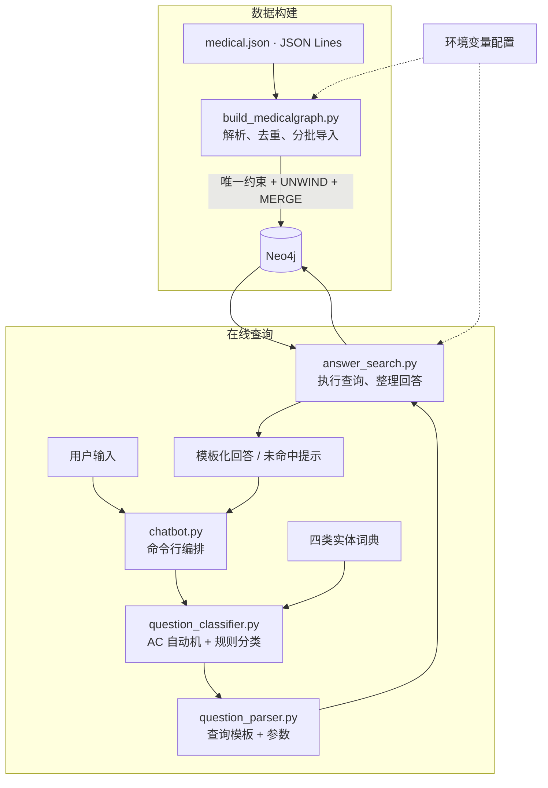
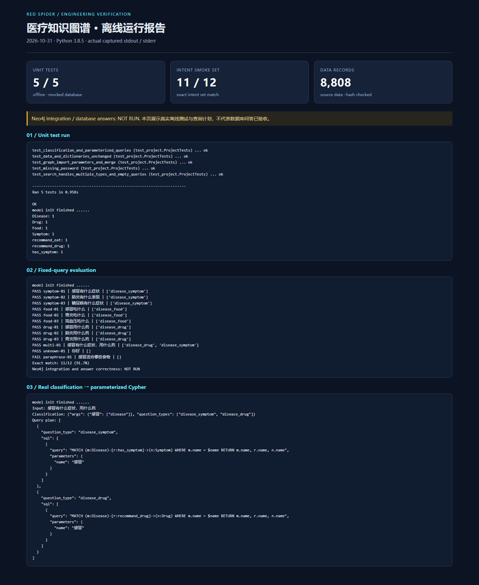
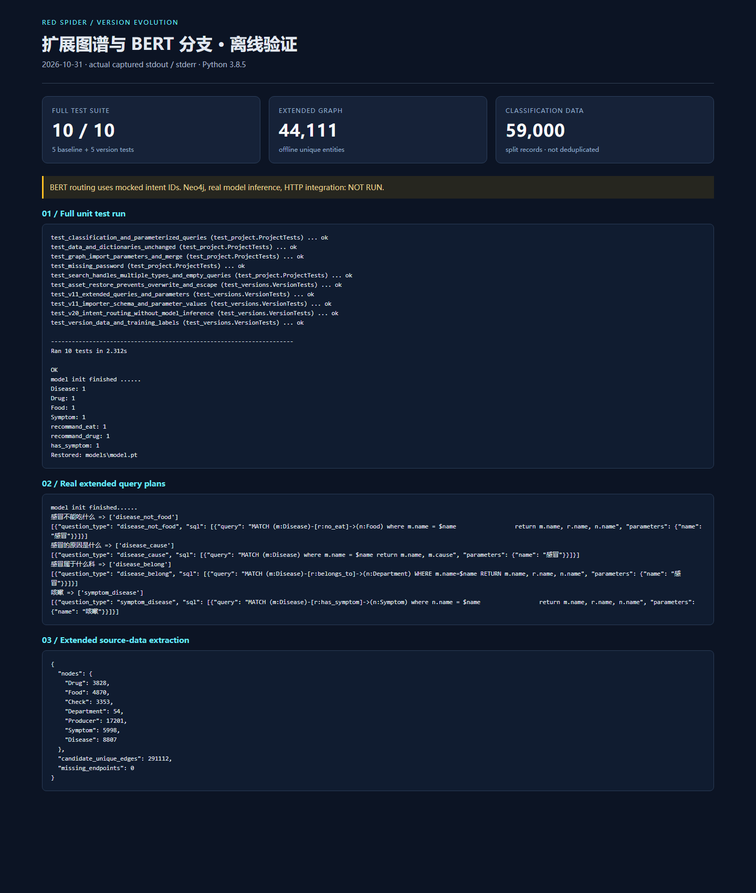

# Red Spider · 医疗知识图谱问答系统

**基于 Python、Neo4j 与 Aho–Corasick 多模式匹配，将疾病、症状、食物和药品组织为可查询的知识图谱，并通过自然语言完成结构化信息检索。**

项目打通“数据解析 → 图谱构建 → 实体识别 → 问题分类 → Cypher 查询 → 模板回答”流程。仓库整理了 v1.0 基础规则版、v1.1 扩展图谱与规则版、v2.0 BERT 分类与服务化版本；下文默认启动和基线数据统计对应 v1.0，后续版本有独立代码、数据说明和启动入口。

**数据规模：8,808 条记录 · 23,111 个去重实体 · 154,396 条去重关系**  
该规模对应 v1.0 的本地源数据统计；v1.1 扩展图谱离线抽取得到 44,111 个实体、291,112 条候选关系，详见[分版统计](docs/version_data_statistics.json)。数据库实测计数尚未核验。

[项目背景](#项目背景) · [系统架构](#系统架构) · [技术栈](#技术栈) · [核心功能](#核心功能) · [测试与评估](#测试与评估) · [运行效果与快速启动](#运行效果与快速启动) · [已知限制](#已知限制)

## 项目背景

医疗信息中，疾病与症状、饮食和药品之间存在大量关联。直接查阅结构化数据文件时，需要理解字段、定位记录并手动组合信息；将这些关系建模为图谱后，可以通过统一的查询路径检索相关实体。

本项目面向疾病相关知识查询，解决两个具体问题：一是将逐行 JSON 数据转成具有唯一实体标识和明确关系的 Neo4j 图谱；二是将中文问句转换成限定范围的图查询，让使用者通过“感冒有什么症状”等自然语言获取数据中已有的信息。

实现重点包括可追踪的数据处理、明确的模块边界、参数化查询、可重复执行的数据导入和可复现的离线验证。系统返回知识库信息，不承担诊断或处方决策。

## 功能版本演进

| 版本 | 主要变化 | 代码与运行说明 | 验证状态 |
| --- | --- | --- | --- |
| v1.0 | 四类实体、三类关系、规则分类与 CLI | 本 README、`red_spider/` | 基础离线测试与 12 条固定问句集 |
| v1.1 | 七类实体和疾病属性，扩展饮食、检查、并发症、科室与反查；Flask、可选生成回退 | [v1.1 说明](versions/v1.1/README.md) | 扩展规则与查询路由离线验证；数据库/API 未联调 |
| v2.0 | BERT 四/十九分类、训练与评估数据、ONNX 导出、Flask/FastAPI | [v2.0 说明](versions/v2.0/README.md) | 数据格式及标签校验、mock 意图路由；模型推理与服务待验收 |

两组 BERT 数据共 59,000 条切分记录；大型权重有来源清单和本地恢复脚本。[完整版本演进与验收边界](docs/version-history.md)保留各阶段的工程变化。各版独立启动；v2.0 使用 v1.1 的扩展建图入口。

## 系统架构



建图与问答分别通过独立入口执行。分类器负责识别实体和查询意图，解析器负责生成查询计划，搜索器负责数据库访问和结果整理，便于独立排查各阶段问题。

## 技术栈

| 层次 | 技术 / 版本 | 项目中的用途 |
| --- | --- | --- |
| 编程语言 | Python，本次实测 3.8.5 | 数据处理、分类、查询和命令行入口 |
| 图数据库 | Neo4j 5.x，实际服务集成待验证 | 存储实体关系；脚本使用 5.x 唯一约束语法 |
| 数据库驱动 | `neo4j==5.28.2` | Bolt 连接、会话和 Cypher 执行 |
| 实体匹配 | `pyahocorasick==2.1.0` | AC 自动机多模式词典匹配 |
| 数据格式 | JSON Lines、UTF-8 文本词典 | 医疗记录、领域实体词表 |
| 验证 | `unittest`、`unittest.mock`、固定问句集 | 单元测试与离线查询意图评估 |
| 配置管理 | 系统环境变量 | 分离数据库配置和源码 |
| 后续模型分支 | PyTorch 2.4.1、Transformers 4.46.3 | BERT 训练与分类代码；真实模型效果尚未验收 |
| 后续导出分支 | ONNX 导出代码、ONNXRuntime 1.19.2 | 导出实验与已有模型资产；未接入默认问答推理 |
| 后续服务分支 | Flask 3.0.3、FastAPI 0.116.1、Uvicorn 0.33.0 | HTTP 表单接口代码；服务联调尚未完成 |
| 可选生成回退 | OpenAI Python SDK 1.82.1 | 兼容 DeepSeek 调用，默认关闭；未实际调用 |

## 核心功能

### 1. 医疗知识图谱构建

读取 `red_spider/data/medical.json`，抽取四类实体和三类关系。节点按名称合并，关系在写入前按起点、终点去重，使用 `UNWIND` 将关系每 1,000 条分批写入。

| 实体 | 数量 | 关系 | 去重关系数 |
| --- | ---: | --- | ---: |
| Disease / 疾病 | 8,807 | Disease → Symptom：`has_symptom` | 54,710 |
| Symptom / 症状 | 5,998 | Disease → Food：`recommand_eat` | 40,221 |
| Food / 食物 | 4,506 | Disease → Drug：`recommand_drug` | 59,465 |
| Drug / 药品 | 3,800 | 合计 | 154,396 |

节点和关系数量来自源数据去重统计。源文件共 8,808 条记录、8,807 个不同疾病名；保留重复记录，构图时合并。关系名称保留现有拼写，以保持查询兼容。

### 2. 实体识别与问题分类

通过四类词典构建 AC 自动机，在一次匹配过程中查找领域实体；对包含关系的命中词优先保留较长实体，再结合问句特征词识别查询类型。

| 问句示例 | 查询意图 | 目标关系 |
| --- | --- | --- |
| 感冒有什么症状 | 疾病症状查询 | `has_symptom` |
| 感冒吃什么 | 推荐食物查询 | `recommand_eat` |
| 感冒用什么药 | 推荐药品查询 | `recommand_drug` |
| 感冒有什么症状，用什么药 | 同一疾病的多意图查询 | 症状 + 药品两组查询 |

### 3. 参数化查询与结果整理

解析器通过固定模板选择节点标签和关系类型，将疾病名称作为 `$name` 参数传入，避免把用户输入直接拼接到 Cypher 中。搜索器逐个处理查询意图，对结果去重并稳定排序，每类回答最多展示 10 项；未命中时给出查询提示。

### 4. 工程处理与取舍

| 实现 | 处理的问题 | 边界 |
| --- | --- | --- |
| 唯一约束 + `MERGE` | 重复导入时避免主动追加同名实体和重复关系 | 不自动清理旧库已有重复关系；重复导入尚未实库验证 |
| 分批写入 + 参数传递 | 控制单批关系写入规模；减少逐条提交 | 整次导入不是一个原子事务，失败后可能部分写入 |
| 环境变量 + `.gitignore` | 数据库密码与源码分离 | `.env` 不会自动加载 |
| 基于脚本位置解析路径 | 从其他工作目录启动时仍能读取数据和词典 | 词典需要与数据保持一致 |
| 模块拆分 + 固定测试入口 | 分类、查询计划、数据库访问可分别排查 | 数据库调用的 mock 测试不能替代集成测试 |

## 测试与评估

完整测试现为 **10/10 通过**，其中 v1.0 基线 5 项、后续版本 5 项；模型路由以 mock 意图编号验证，完整结果见 [版本验证记录](docs/version_verification.md)。

### 自动化测试

在仓库根目录执行：

```powershell
python -m unittest discover -s tests -v
python -m compileall -q red_spider versions tests
```

v1.0 基线：**5 项测试通过**，覆盖完整 JSON 解析与数据/词典哈希、三类问句分类和参数查询、多意图及空查询、建图参数和去重、缺少密码时的配置错误。根目录和外部工作目录均已验证；数据库调用使用 mock。

### 固定问句评估

```powershell
python tests\evaluate.py
```

评估脚本使用真实词典、分类器和解析器，按“生成的查询意图集合是否与人工预期完全一致”评分。12 条人工固定冒烟案例包含单意图、多意图、未命中和改写问句，结果为 **11/12（91.7%）**。该结果仅描述这份小型固定集，不代表医疗答案准确率或真实用户泛化能力。

已发现失败案例：`感冒适合哪些食物` 预期命中推荐食物，当前未生成查询，表明规则对表达方式仍然敏感。案例保留在固定集中，便于后续比较修复前后结果。

- [固定问句与预期](tests/evaluation_cases.json)
- [逐条评估结果](docs/evaluation_results.json)
- [真实测试输出](docs/test_output.txt) · [评估输出](docs/evaluation_output.txt)

Neo4j 首次导入、重复导入和真实问答尚未完成集成验证；当前没有端到端答案质量、并发吞吐或延迟基准。集成验收应在专用空库导入两次，核对节点与关系计数，再执行三类问答并与数据记录比对。

## 运行效果与快速启动

### 离线运行截图

下图为本地验证报告的浏览器截图，内容来自本次真实运行的单元测试、固定问句评估和分类至 Cypher 的查询计划输出。该图记录 v1.0 基线的可复现离线处理结果，未连接 Neo4j；后续版本的独立验证结果见 [版本验证记录](docs/version_verification.md)。



[打开 v1.0 运行报告](docs/run-report.html) · [查看基线查询计划](docs/query_plan_output.txt)

后续版本的真实离线运行记录如下；扩展查询使用实际规则和词典，BERT 路由使用 mock 意图编号，模型推理和实库问答尚未执行。



[版本验证记录](docs/version_verification.md) · [扩展查询输出](docs/version_query_output.txt)

### 安装与配置

下载或克隆后进入仓库根目录。以下为 PowerShell 命令；使用前准备好 Neo4j 5.x 服务和专用空数据库。

```powershell
cd medical-knowledge-graph
python -m venv .venv
.\.venv\Scripts\Activate.ps1
python -m pip install -r requirements.txt

$env:NEO4J_URI = 'bolt://localhost:7687'
$env:NEO4J_USER = 'neo4j'
$env:NEO4J_PASSWORD = '填写你自己的数据库密码'
```

未设置密码时程序会明确报错；URI 和用户名的默认值分别是 `bolt://localhost:7687` 和 `neo4j`。`.env.example` 仅为变量说明，程序不会自动加载其中内容。若 PowerShell 限制激活脚本，可直接使用 `.\.venv\Scripts\python.exe` 代替后续命令中的 `python`。

### 构建图谱并启动问答

在同一个已设置环境变量的终端中执行：

```powershell
python red_spider\build_medicalgraph.py
python red_spider\chatbot.py
```

建图脚本向指定数据库写入数据，不清空已有数据；已有同名重复节点可能使唯一约束创建失败。导入出错后先查看错误信息，排查连接、权限或数据问题再重跑。

问答启动后输入“感冒有什么症状”“感冒吃什么”“感冒用什么药”。输入 `q` 或按 Ctrl+C 退出，程序关闭数据库客户端连接；Neo4j 服务单独管理。

可在 Neo4j Browser 执行以下语句检查某个疾病的关系：

```cypher
MATCH (d:Disease {name: '感冒'})-[r]->(n)
RETURN d, r, n LIMIT 50;
```

### 常见启动问题

| 现象 | 排查方式 |
| --- | --- |
| 提示设置 `NEO4J_PASSWORD` | 在运行程序的同一终端设置环境变量 |
| 无法连接或认证失败 | 检查服务是否启动、URI、Bolt 端口和账号密码 |
| 创建约束失败 | 检查账号建约束权限，以及库内是否已有同名重复节点 |
| 识别到疾病却没有回答 | 分别检查分类结果、查询意图、图谱是否导入及实体名称是否一致 |

## 项目目录

```text
medical-knowledge-graph/
├── README.md
├── AGENTS.md                       # 开发约定
├── requirements.txt
├── .env.example
├── .gitignore
├── red_spider/
│   ├── build_medicalgraph.py        # 数据解析与图谱写入
│   ├── question_classifier.py      # 实体识别与规则分类
│   ├── question_parser.py          # 参数化查询计划
│   ├── answer_search.py            # 数据库访问与答案整理
│   ├── chatbot.py                  # 命令行交互
│   ├── config.py                   # 环境变量配置
│   ├── data/medical.json           # 完整医疗数据
│   └── dict/                       # 疾病、症状、食物、药品词典
├── tests/
│   ├── test_project.py             # 单元测试
│   ├── evaluation_cases.json       # 固定问句集
│   ├── evaluate.py                 # v1.0 离线评估入口
│   └── test_versions.py            # 后续版本与数据验证
├── versions/
│   ├── v1.1/                       # 扩展图谱、规则、Flask、模型回退
│   └── v2.0/                       # BERT、训练数据、ONNX、服务接口
└── docs/                           # 来源、统计、分版验证与运行图
```

## 工程迭代

以下为当前独立项目的整理与验证记录，均发生于 2026-10-31。

| 轮次 | 变化 | 验证与结果 |
| --- | --- | --- |
| 第 1 轮：基础模块与运行修正 | 整理建图、分类、解析和搜索模块；修复路径与搜索循环问题；引入参数查询、环境变量和关系合并 | 5 项离线测试、代码编译及数据哈希校验通过 |
| 第 2 轮：结构和启动统一 | 统一 `red_spider/` 下的代码、数据、词典；同步测试与命令，精简目录 | 从仓库根目录及外部目录运行测试通过，完整数据路径验证通过 |
| 第 3 轮：可展示、可复现的验证 | 完善架构、技术选型、启动排障；新增固定问句评估、原始运行日志和报告截图 | 单元测试 5/5；固定问句意图集合精确匹配 11/12，保留失败案例 |
| 第 4 轮：完整版本整理 | 纳入 v1.1 扩展图谱、v2.0 BERT/服务代码及完整分类数据；补齐分版说明、密钥隔离、路径修正及模型资产恢复 | 分版结果见 [版本验证记录](docs/version_verification.md)，未将源文件存在视为功能已验收 |

后续继续记录具体改动、验证范围和结果；Neo4j 与真实模型集成、答案正确性和性能仍待验证。

## 已知限制

- **表达覆盖有限**：分类基于词典和规则，对同义表达、口语和错别字不够稳健；固定集已保留一个食物查询改写失败案例。
- **版本边界**：v1.0 仅支持三类基础查询；v1.1 已整理扩展图谱、检查、科室与反查代码，v2.0 已整理模型分类和接口代码，详见分版验收状态。各版均未实现可靠的跨轮指代与多轮上下文。
- **多疾病回答待完善**：搜索器对同一意图的结果统一整理，多个疾病同时出现时缺少可靠的分组展示；当前示例聚焦单一疾病。
- **数据质量依赖来源**：词典与数据尚无自动同步机制；字段格式、重复记录和过时内容仍需专门治理。模板回答最多展示 10 项，当前没有分页。
- **导入能力边界**：数据一次性载入内存；多批事务不提供整次导入回滚，不自动清理旧库已有重复关系，也没有删除同步机制。
- **验证边界**：尚未完成真实数据库集成、端到端答案评估、负载测试和线上部署验证；离线结果不能外推为生产可用性。
- **使用边界**：医疗信息检索不能替代专业诊断或用药建议。

## 数据来源与许可

数据来自本项目已有的 `medical.json` 和四份实体词典，原样保留；数据文件为 JSON Lines，大小 47,138,917 字节。[来源清单](docs/source_manifest.json)保留原文件路径、大小和 SHA-256，[数据统计](docs/data_statistics.json)记录去重结果。

原始代码与数据的公开许可尚未确认，项目未自行附加开放许可证；对外再分发前需确认授权和署名要求。
