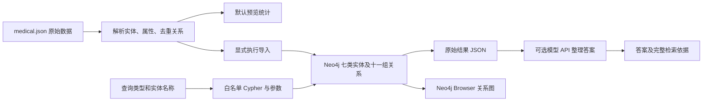
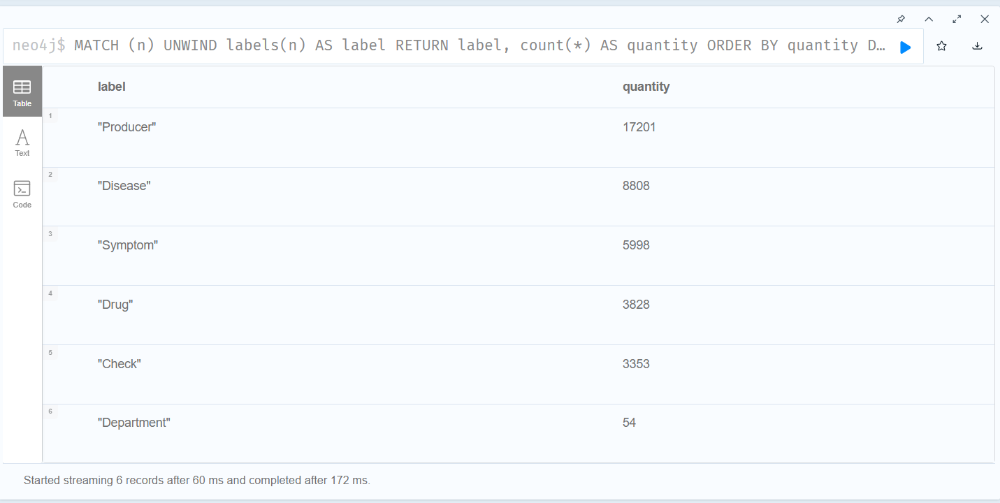
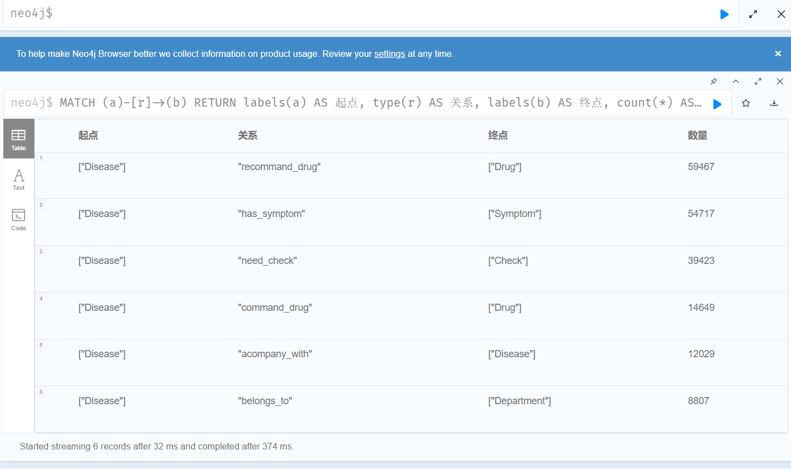

# 青囊 · 医疗知识图谱

**检索增强版 1.1.0：基于 Python 与 Neo4j 的医疗数据建模、批量导入和结构化查询项目。**

## 项目背景

医疗数据中的疾病、症状、药品、检查、食物、科室及生产商分散在不同字段中。本项目将这些实体与关系写入 Neo4j，提供可检查的参数化查询和图谱展示，方便追踪每条结果的关系来源。

查询链路：选择查询类型和实体名称 → 生成 Cypher 与参数 → 访问 Neo4j → 输出原始记录。支持可选的一次性检索增强回答：先检索 Neo4j，再将问题及检索记录交给配置的模型 API。查询类型与实体由命令参数明确指定，不让模型生成或执行 Cypher；没有多轮聊天、本地答案回退或 Agent 循环。JSON 仅用于构图。

## 系统架构



## 技术栈

| 技术 | 用途 |
| --- | --- |
| Python | JSON Lines 解析、命令行入口、数据校验 |
| Neo4j 5.x | 属性图存储和 Cypher 查询 |
| neo4j Python Driver 5.28.2 | 参数化查询、连接及事务会话 |
| unittest | 数据完整性、查询参数、导入行为验证 |

## 图谱结构与核心功能

- 原始数据：8,808 条记录，对应 8,807 个不同疾病名称。
- 完整扩展数据可解析出 44,111 个不同实体，291,112 条去重候选边；这是离线数据统计，不是当前数据库实测计数。
- 7 类节点：Disease、Symptom、Drug、Food、Check、Department、Producer。
- 11 组关系（10 个不同关系类型）：疾病—检查、疾病—推荐食物、疾病—忌食、疾病—宜食、科室—上级科室、疾病—常用药品、生产商—药品、疾病—推荐药品、疾病—症状、疾病—伴随疾病、疾病—科室。两组科室关系共用 belongs_to。
- 疾病节点保留简介、病因、预防、治疗方式等已有属性。
- 数据导入使用唯一约束、MERGE 和分批写入；先检查已有同名重复节点。
- 结构化查询支持节点/关系统计、邻居、疾病药品、症状、检查、饮食、科室、症状反查疾病和药品生产商。

## 安装与配置

以下命令在项目根目录的 PowerShell 执行：

```powershell
python -m venv .venv
.\.venv\Scripts\python.exe -m pip install -r requirements.txt
$env:NEO4J_URI = 'bolt://localhost:7687'
$env:NEO4J_USER = 'neo4j'
$neo4jPassword = Read-Host 'Neo4j 密码' -AsSecureString
$env:NEO4J_PASSWORD = [System.Net.NetworkCredential]::new('', $neo4jPassword).Password
$env:NEO4J_DATABASE = 'neo4j'
```

数据库名称应与自己的实例一致；未设置时使用用户默认库。程序不自动读取 `.env`。仅预览数据或查询计划无需数据库账号。

## 构图与运行

### 1. 预览完整图谱数据

```powershell
python qingnang/build_medicalgraph.py
```

默认不连接数据库，输出实体及关系候选计数。可用 `--data` 指定其他相同结构的 JSON Lines 文件。

### 2. 在专用空库导入

```powershell
python qingnang/build_medicalgraph.py --execute
```

此命令会创建约束、实体、属性和关系。已有重复名称时在写入前停止，不自动删除或合并。应先备份并单独处理旧数据，或使用专用空库验证；当前已知旧库有重复疾病，不要直接依赖重复导入解决。

### 3. 展示查询计划与执行结果

```powershell
# 不连接数据库：展示即将执行的 Cypher 和参数
python qingnang/query_graph.py drugs --name 感冒 --plan-only

# 连接数据库：输出同一查询的原始记录
python qingnang/query_graph.py drugs --name 感冒 --limit 20
python qingnang/query_graph.py symptoms --name 感冒
python qingnang/query_graph.py checks --name 感冒
python qingnang/query_graph.py neighbors --name 感冒
python qingnang/query_graph.py schema
python qingnang/query_graph.py relations
```

输出包含 `cypher`、`parameters`、`source: neo4j`、`returned_count`、`limit` 和 `records`。没有数据时返回空列表。连接或权限错误直接报错，不将其伪装成无结果。

查询药品时同时覆盖 `command_drug` 和 `recommand_drug`，并保留关系类型。`--limit` 允许 1–1000，默认20；返回条数不是匹配结果总数。排序为文本顺序，无医学排序含义。

### 4. 在 Neo4j Browser 展示节点连线

打开自己实例的 Neo4j Browser，执行 [图谱演示语句](docs/demo.cypher)：

```cypher
MATCH (d:Disease {name: '感冒'})-[r:command_drug|recommand_drug]->(n:Drug)
RETURN d, r, n LIMIT 30;
```

切换到 Graph 视图即可查看节点与边。Python 入口展示查询和表格记录，Browser 展示同一条关系路径。完整库结构检查见 [inspect_graph.cypher](docs/inspect_graph.cypher)。

## 真实运行效果

以下截图来自已有 Neo4j 实例的实际只读查询，不代表本版导入已通过验收：





截图显示当前实例包含6类节点、6组关系，无 Food 节点；有 Producer 节点但没有 drugs_of 边。完整缺失对照见 [版本与数据库状态](docs/version-history.md)。

## 测试与评估

```powershell
python -m unittest discover -s tests -v
python -m compileall -q qingnang tests
```

验证覆盖：原始数据 SHA-256、七类实体计数、两种药品关系查询、参数隔离、非法查询类型/上限拒绝、查询返回记录及连接关闭、默认导入不连接数据库、已有重复节点在写入前拦截。

数据库交互测试使用 mock；记录见 [verification.md](docs/verification.md)。未完成新导入脚本的真实空库首次/重复导入验证，不声称性能、答案准确率或部署效果。

## 项目目录

```text
qingnang/
├── README.md
├── AGENTS.md
├── requirements.txt
├── .env.example
├── qingnang/
│   ├── build_medicalgraph.py  # 完整扩展图谱解析、预览与导入
│   ├── query_graph.py         # 白名单结构化只读查询
│   ├── grounded_answer.py    # 单次检索 + 模型整理回答
│   ├── verify_graph.py       # 全量源实体与关系覆盖核查
│   ├── config.py             # 环境变量配置
│   └── data/medical.json     # 原始数据
├── tests/test_graph_only.py
└── docs/                     # 来源、统计、版本、截图、Cypher 与验证
```

## 工程迭代与版本

当前独立项目标记为 **检索增强版 1.1.0**，版本号表示本次收敛后的交付范围。其建图代码继承原 v1.1 的完整扩展模型，不等于原四类实体的基础 v1.0。

原 v2.0 主要增加 BERT 分类、训练、ONNX 和服务入口，复用 v1.1 建图。没有独立的“2.0 专属关系”。本项目移除了历史聊天、意图分类、训练数据和 Web 对话接口；按新的需求新增一个独立、可选的单次检索增强 API 入口。

| 日期/阶段 | 实际变化 | 验证 |
| --- | --- | --- |
| 2026-10-31 至 2026-11-01，收敛前 | 完整数据及扩展模型提取，参数化查询、配置隔离，规则查询修复 | 当时有25项旧范围测试；包含现已移除功能，不作为本版测试成绩 |
| 2026-11-01，图谱版1.0.0（上一阶段） | 移除对话与模型模块；统一扩展构图、只读查询、计划展示、重复节点预检和数据库名称配置 | 本版验证单独记录于 docs/verification.md |

## 已知限制

- 当前旧库少一类实体和五组关系，且 Disease 数量高于源数据去重数量；截图无法判断每个重复节点和缺失关系的具体原因。
- 导入是多批事务，失败可能留下部分数据；不提供整次回滚或自动旧库去重，不删除不再出现在数据源中的记录。
- 同名疾病源记录合并到一个节点，属性按数据文件顺序更新，后出现的属性可覆盖前值；尚无字段级冲突治理。
- 部分数据有历史拼写如 recommand_drug、command_drug、acompany_with，保留以兼容已有实例。
- 生产商名称解析沿用源字段的括号拆分逻辑，真实业务含义和数据质量需独立核验。
- 不实现症状到药物的诊疗推断。问题可为自然语言，但检索类型及实体仍需显式提供；不支持自由问句自动路由和多轮对话。
- 模型依据约束通过提示实现，不能保证完全无幻觉；请结合输出的原始记录核对。调用模型会将当前问题和选定检索记录发送到配置的服务商。
- 查询采用固定上限，未提供分页、访问鉴权或性能基准。读取全库结构统计可能耗时。
- 医疗关联记录不构成诊断或处方。

## 数据来源与许可

数据来自已有项目保存的 medical.json（JSON Lines，47,138,917字节），保持原始字节。[来源清单](docs/source_manifest.json)记录 SHA-256，[扩展数据统计](docs/version_data_statistics.json)记录离线实体与关系计数。

原始代码和数据的公开许可尚未确认，本项目未自行附加开放许可证；公开再分发前应确认授权和署名要求。


## v1.1 完整数据补齐与模型检索增强（2026-11-01）

### 补齐旧库的全部节点与关系

先备份数据库，在已设置 Neo4j 环境变量的终端执行：

```powershell
python qingnang/build_medicalgraph.py --execute --complete-existing
python qingnang/verify_graph.py
```

补齐模式处理完整7类节点、11组关系，不局限于当前缺少的5组。保留旧库同名节点和旧关系；同名实体以 elementId 文本排序的首个节点作为新写入关系的固定端点，补充该疾病节点的源属性。同名节点不会自动合并，旧数据仍可查询到；这不是去重迁移。没有重复名称的标签建立唯一约束，有重复名称的标签跳过该约束。模式只适用于单进程导入，不保证并发写入安全。

执行采用多批事务，失败后可能已经部分写入。已有疾病属性可能被源数据同名字段更新；导入前备份。数据重复名称的属性按源文件顺序覆盖。

verify_graph.py 将原始数据中的每个实体名称和每个关系端点名称对与数据库逐批比对。所有组 missing 为0才返回 complete:true，缺少时退出码为1。此验证检查存在性，不检查重复数量、字段值或医学有效性。

### 模型 API 配置

兼容 Chat Completions 的 HTTPS 接口。填入自己的地址和模型名，API Key在本地隐藏输入，不写入源码：

```powershell
$env:LLM_BASE_URL = '填写兼容接口根地址，通常以/v1结尾'
$env:LLM_MODEL = '填写服务商提供的模型名'
$modelKey = Read-Host '模型 API Key' -AsSecureString
$env:LLM_API_KEY = [System.Net.NetworkCredential]::new('', $modelKey).Password
python qingnang/grounded_answer.py --operation foods --name 感冒 --question '感冒吃点什么？'
```

LLM_BASE_URL不包含 /chat/completions 后缀，程序会添加该路径。接口依据 [Chat Completions官方文档](https://api-docs.deepseek.com/api/create-chat-completion/) 实现，但不绑定供应商或固定模型名。HTTP错误和超时明确报错，不自动重试以免重复计费。

入口只执行一次。返回 answer、retrieval（包含Cypher、参数和原始记录）、model_called。没有检索记录时不调用模型。模型收到问题和当前查询的有限条数记录，不会收到数据库密码或整个原始数据文件。药品答案展示数据库记录，不据此推导症状处方和剂量。

### 本轮验证状态

13项单元测试通过，覆盖模型请求构造、检索依据保留、空结果不调用模型、配置缺失、旧库补齐路径和全量覆盖核查。测试使用数据库/HTTP替身，未消耗真实API额度。本机工具环境没有Neo4j密码及模型Key，实际数据库导入和真实模型联调尚未执行。文件修改仍在D盘副本，E盘和GitHub尚未同步。
