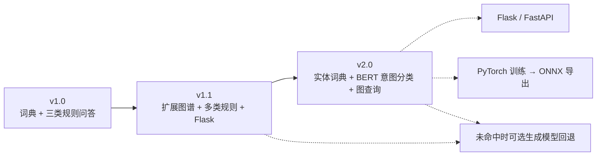

# 项目功能演进与验收边界

版本编号沿用已有工程，原始开发日期未确认；本次整理日期为 2026-10-31。

| 版本 | 解决的问题 | 已整理内容 | 验证边界 |
| --- | --- | --- | --- |
| v1.0 | 基础疾病信息查询 | 四类实体、三类关系、AC 匹配、规则分类、参数化查询、CLI | 基础单元测试与固定问句评估；未完成实库验证 |
| v1.1 | 扩大关系和查询覆盖面 | 七类实体、疾病属性、饮食禁忌/并发症/检查/科室/反查、Flask、可选模型回退 | 扩展规则与查询计划离线验证；未完成数据库/API/模型联调 |
| v2.0 | 将规则意图识别迭代为模型分类并保留服务接口 | 四类与十九类 BERT 分支、59,000 条训练/验证/测试记录、训练/评估、ONNX 导出、Flask/FastAPI | 数据校验与 mock 意图路由；未执行真实模型推理、训练或加速测试 |

## 架构变化

图中的模型、服务和回退路径已包含代码，尚未完成端到端验收。v2.0 的实际分类入口使用 PyTorch，ONNX 导出是独立实验路径。

## 数据及模型

- 医疗结构化数据共享 `red_spider/data/medical.json`，保持原始字节不变。
- 每个后续版本保留自身八份词典，避免无依据地替换版本数据。
- v2.0 两组分类数据合计 59,000 条切分记录（40,000 + 19,000），不等同于 59,000 条去重独立问句。
- 模型二进制合计约 1.64 GB，来源、大小、哈希见 `model_assets.json`，支持通过 `prepare_model_assets.py` 从本地恢复；不装入源代码发布压缩包。
- 后续版本代码和数据的来源/当前哈希见 `version_source_manifest.json`，修正后的代码与原代码分别记录。

## 整理时修复的工程问题

Windows 和固定机器路径、硬编码服务密钥、查询值拼接、饮食否定意图漏加、关系端点类型和药品关系名不一致、BERT checkpoint/ONNX 混用、模型输入接口不一致及重复推理。

这些改动用于恢复可移植结构和明确模块契约，不代表业务效果或线上性能已改善。医疗答案、数据切分独立性、模型质量、完整图谱写入、接口行为与并发仍需独立验收。

## 复现入口

- v1.0：根 README。
- v1.1：`../versions/v1.1/README.md`。
- v2.0：`../versions/v2.0/README.md`。
- 自动化验证：根目录 `python -m unittest discover -s tests -v`、`python -m compileall -q red_spider versions tests`。
