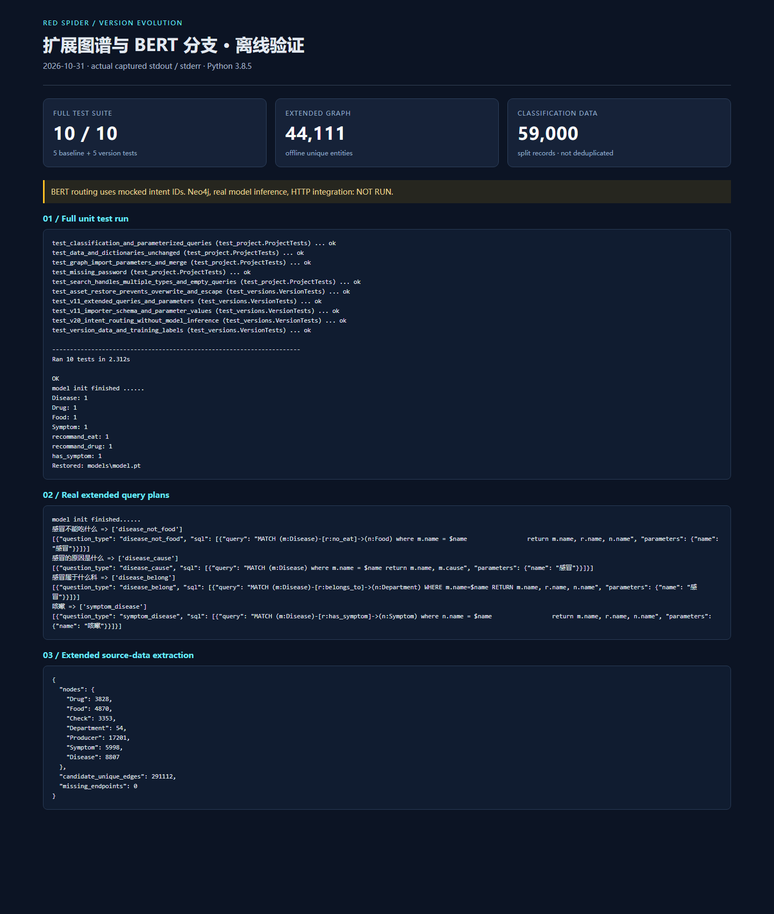

# v1.1 · 扩展知识图谱与规则问答

在 v1.0 三类查询基础上，扩展疾病属性、检查、科室、药品厂商、饮食禁忌、并发症与反向关系查询。保留规则分类、Flask 接口和可选生成模型回退入口。

## 结构与数据

- 本目录保存本版独立 Python 模块、八份 `dict/*.txt`，共用仓库内 `../../red_spider/data/medical.json`。
- 可用环境变量 `MEDICAL_DATA_PATH` 指定另一份医疗数据；默认路径不依赖原电脑目录。
- 建图抽取 Drug、Food、Check、Department、Producer、Symptom、Disease 七类实体，并写入疾病描述、病因、预防、治疗周期等属性。
- 关系组覆盖检查、推荐/宜吃/忌吃、常用/推荐药、药厂、症状、并发症和科室归属。疾病与科室、子科室与父科室共用 `belongs_to` 类型。

## 启动

在仓库根目录运行，先按根 README 设置 Neo4j 环境变量：

```powershell
python -m pip install -r versions\v1.1\requirements.txt
python versions\v1.1\build_medicalgraph.py
python versions\v1.1\chatbot.py
```

请在专用空库使用本版建图，不要将基础版图谱当作扩展版完整数据。示例输入：“感冒的原因是什么”“感冒不能吃什么”“感冒属于什么科”“咳嗽”。以上输入的离线分类与查询路由已验证，真实数据库答案尚未验证。

Flask 接口：

```powershell
cd versions\v1.1
python -m flask --app app run --host 127.0.0.1 --port 5001
```

接口为 `POST /v1/main_server/`，表单字段 `uid`、`text`，返回字符串。`app.py` 保留原有模块导入时初始化行为；启动需要数据库配置。接口未完成实库联调，不包含鉴权或限流。

`robot.py` 提供可选生成模型回退，默认关闭。通过 `LLM_BACKEND=deepseek` 及 `DEEPSEEK_API_KEY` 显式开启远程回退；该路径可能产生外部 API 费用，本次没有调用。`gpt2.py`、`qwen.py` 保留本地模型适配器，模型文件和兼容性未验证，未默认加载。

## 整理时修正

- 将数据库配置与原硬编码服务密钥改为环境变量，模型适配器按需导入。
- 修正 Windows 路径、词典资源关闭、否定饮食意图未加入结果、症状反查路由和科室查询缺口。
- 查询值改为参数，常用药关系名与建图脚本的 `command_drug` 对齐，并保留常用药与推荐药两组查询。
- 建图使用参数、唯一约束和批量 `MERGE`，补齐 Food 节点、科室层级关系及 Producer → Drug 的端点类型；保留 `cured_prob` 属性名与查询一致。
- 不再吞掉导入错误；导入中断仍可能已有部分写入。节点名与边端点在源数据中不一致时，`MATCH` 会跳过相应关系，需在集成验收中核对。

## 验证状态

根目录 `python -m unittest discover -s tests -v` 包含本版否定饮食、病因、科室、症状反查、双药品查询及参数隔离检查。完整数据抽取统计见 `../../docs/version_data_statistics.json`。

Neo4j 首次/重复导入、真实 Flask 请求、生成模型输出、医疗答案正确性和性能测试尚未验证。

## 本次整理的运行记录

[完整分版验证记录](../../docs/version_verification.md) · [真实查询计划输出](../../docs/version_query_output.txt)



图中展示真实离线验证，BERT 路由测试使用 mock 意图编号，未执行真实模型推理或数据库问答。
