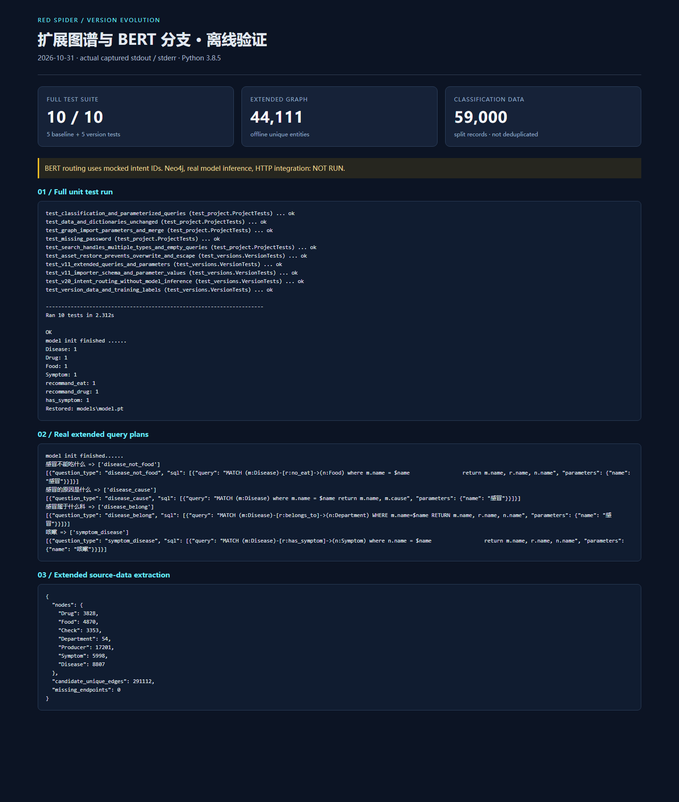

# v2.0 · BERT 意图分类与服务化

在扩展图谱查询流程中，引入 BERT 问句意图分类，保留训练、评估、ONNX 导出、Flask/FastAPI 入口和可选生成模型回退代码。该版本整理了真实代码及训练数据；模型与数据库端到端效果仍待重新验收。

## 训练数据与模型

| 数据目录 | 标签数 | train | dev | test |
| --- | ---: | ---: | ---: | ---: |
| `bert/project_data/` | 4 | 32,000 | 4,000 | 4,000 |
| `bert/project_data_19/` | 19 | 15,200 | 1,900 | 1,900 |

两组数据、类别文件、词表、数据生成脚本和训练代码均已整理，原始内容按 SHA-256 校验。行数和标签范围已离线验证；数据切分的独立性、重复样本和泄漏情况尚未审计。不能据此声称模型准确率。

- `question_classifier.py`：保留四分类实验分支。
- `question_classifier_19.py`：默认十九分类分支，供 `chatbot.py`、`robot.py`、`app.py`、`fast.py` 使用。
- `bert/run.py`、`train_eval.py`、`utlis.py`：训练、测试和数据加载。
- `bert/models/bert.py`：BERT 与分类层，兼容训练元组输入及导出所需三张量输入。
- `bert/onnx/bert2onnx.py`：导出 ONNX；当前问答分类器实际走 PyTorch 推理，没有默认接入 ONNXRuntime 推理，尚无加速对比。
- `question_parser.py`、`answer_search.py`：沿用扩展图谱查询；七类实体的建图入口复用 `../v1.1/build_medicalgraph.py`。

## 模型资产准备

已有工程包含 `pytorch_model.bin`、`bert.pt`、`bert_19.pt`、`bert_19.onnx` 四个大文件，合计约 1.64 GB。代码压缩包不包含这些二进制权重，`../../docs/model_assets.json` 记录准确路径、大小及 SHA-256；词表与配置文件已包含。

在仓库根目录执行以下命令，可从自己已有的本地模型文件恢复，无需网络下载：

```powershell
python versions\v2.0\prepare_model_assets.py --source E:\vscode\project3\red_spider\v2.0
```

`--source` 指原始 `v2.0` 文件夹，换电脑后应改为实际路径。脚本先校验所有来源文件，限制目标路径范围，不覆盖内容不同的目标文件；本次未执行完整大模型复制，已用小型临时文件验证复制、拒绝覆盖和路径越界。

## 环境与启动

根目录基础测试环境为 Python 3.8.5；本目录依赖文件记录本机已有相关包版本，未重新安装或验收整套模型环境。`python-multipart` 和 `onnx` 是额外的表单/导出依赖，本机未确认可用，未锁定版本。建议单独准备环境并实际验证兼容性。

```powershell
python -m pip install -r versions\v2.0\requirements.txt
# 按根 README 设置 NEO4J_URI、NEO4J_USER、NEO4J_PASSWORD
python versions\v1.1\build_medicalgraph.py
python versions\v2.0\chatbot.py
```

`chatbot.py` 已恢复“分类 → 解析 → 图查询 → 回答”的完整路径；原入口曾在分类后提前返回。运行前必须准备模型资产和扩展图谱；本次没有以真实权重执行该流程。

训练和导出入口：

```powershell
cd versions\v2.0\bert
python run.py --model bert
python onnx\bert2onnx.py
```

默认训练十九分类数据，保存 `bert/save_path/bert_19.pt`；ONNX 导出到同目录 `.onnx`。重新训练可能覆盖已有同名 checkpoint，执行前自行备份。四分类分支使用 `bert.pt`，与十九分类权重分开。

Flask 与 FastAPI（在仓库根目录先进入版本目录）：

```powershell
cd versions\v2.0
python -m flask --app app run --host 127.0.0.1 --port 5001
python fast.py
```

各版本分进程运行，避免同名模块导入歧义。Flask 路由 `POST /v1/main_server/`，表单字段 `url`、`text`；FastAPI 路由 `POST /v1/main_server`，表单字段 `uid`、`text`。两者为独立入口，不应同时占用同一端口。FastAPI 原入口绑定 `0.0.0.0:5001`，无鉴权，建议在受控本机环境验收。

## 整理修正与剩余缺口

- 移除硬编码 API 密钥及固定电脑数据路径；数据库密码使用环境变量。
- 区分 `.pt` checkpoint 和 `.onnx` 导出路径；修正模型前向接口、设备迁移、每问句重复调用分类器的问题。
- 统一 `[CLS]` 和 32 token 长度，修正小于一个 batch 时迭代器的除零问题。原预处理存在不一致，已有权重必须重新评估，不能假设修正后效果保持不变。
- 将 `disease_ckeck` 标签兼容映射为 `disease_check`；补齐科室查询。十九标签中的 `disease_not_easyget` 仍没有查询与回答映射，保留为明确未完成项。
- 当前测试通过 mock 固定意图编号检查路由，不执行 BERT 推理；训练数据完成行数、格式和标签范围校验。
- 原模型中的部分层冻结写法、遗留实验分支、局部结果模板和医疗语义正确性仍待专项审查。
- Flask/FastAPI 导入时会初始化模型，异步路由内仍调用同步查询；缺少鉴权、限流、超时隔离及生产部署验证。
- DeepSeek/GPT2/Qwen 回退适配器保留，默认关闭；没有调用外部 API、训练模型或声称推理精度和加速比例。

## 本次整理的运行记录

[完整分版验证记录](../../docs/version_verification.md) · [真实查询计划输出](../../docs/version_query_output.txt)



图中展示真实离线验证，BERT 路由测试使用 mock 意图编号，未执行真实模型推理或数据库问答。
